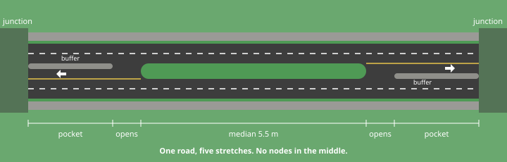
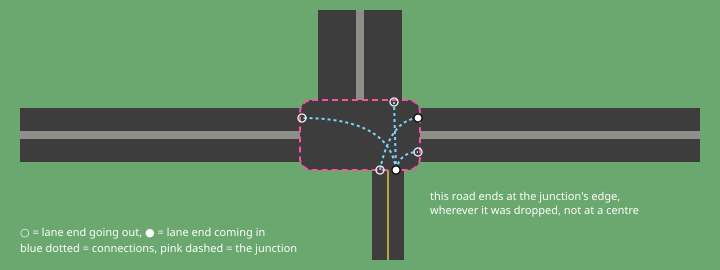
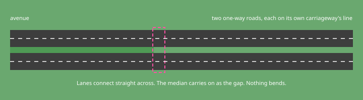
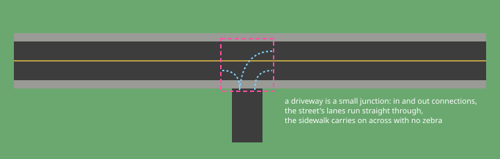

# How the map would be stored

Draft for review. Nothing here is built.

The idea in one line: the map stores what you mean, and the drawing only draws what is stored. The drawing never guesses what kind of junction or road it is looking at.

## Roads

A road is a line you draw, straight or curved. Across it sits a list of lanes, side by side: car lanes, buffers and medians, grass, sidewalks. Later there will be bus and bike lanes too.

Along its length, a road is split into stretches. At the start of a stretch a lane can begin, end, or change width over a distance you set (a taper). A turn pocket is a lane that begins 50 m before the junction. It's one road with a few stretches, and there's no cutting and no extra nodes.

Each stretch has an alignment that says which part of the lanes sits on the line you drew: the left edge, the centre or the right edge. Centre is the default. When a lane is added on the left with left alignment, everything else stays put. With centre alignment the road widens evenly on both sides.

Every road also stores its height along its length. It is flat for now, so bridges can come later without changing the map again.

## Junctions

A junction is a group of road ends. It has no centre point and no fixed shape. A road ends at the junction's edge wherever you drop it.

A junction stores its connections. Each one says "this incoming lane can drive into that outgoing lane". Crosswalks are connections between walking ends, and bike crossings will work the same way.

The drawing follows from those connections:

- Asphalt goes wherever a connection runs.
- An area the connections surround but never cross is an island. The triangle at US 1 is one.
- Outside the asphalt is ground, and sidewalks follow the asphalt's edge.
- Stop lines and turn arrows come from each lane's connections and the junction's settings.

Any place where paths connect or cross is a junction. A driveway is a small junction. So is a mid-block crosswalk, and so is the point where an avenue splits into two roads.

## What you control

These are stored on the map and always win over anything the app would pick:

- Lane alignment on each stretch of road.
- Each crosswalk, on or off.
- Stop, yield or signal on each approach to a junction.
- Each island's surface: grass, concrete or paved.
- The connections themselves.

## Defaults and your edits

When you draw, the app fills in sensible connections, crosswalks and controls, and saves them. They are ordinary data from then on. You can see them and change them, and the app never quietly recalculates them.

If you change a road later, your edits stay for as long as the lanes they refer to still exist. A new lane gets defaults. When a lane you edited disappears, that edit goes, and the junction gets marked so you can see something changed.

## Two levels of editing

Drawing works like today. Drag a road preset across another road and you get a junction with predictable defaults. Plain crossings, T junctions, side streets and driveways never need more than that.

Double-clicking a junction opens the intersection editor. There you can drag a road end or a single lane end along the junction's edge, add or remove connections, flip crosswalks and controls, and set island surfaces. Later it could also turn a junction into a roundabout in one step.

## Your examples

The pocket is one road with stretches: the middle median ends, the turn lane opens beside it, and the pocket buffer runs to the stop line.

The off-centre road ends at the junction's edge under the right-hand half and connects to the other roads lane by lane.

The avenue splitting is a junction of three road ends. Each one-way road continues its own carriageway in a straight line, and the median carries on as the gap between them.

The roundabout's ring is a set of one-way roads. Each entry is a junction where traffic coming in yields to the ring. Splitter islands appear where an entering road has a median.

US 1 and SW 152nd is one big junction where the busway crossing and US 1 sit a few metres apart. It has about 60 lane ends and 70 connections. The driveways and bus bays along SW 152nd are small junctions of their own, and the turn lanes, bus lane and centre turn lane are stretches of road.

## Why changing a layout shouldn't break it

This is the failure you've seen before. A design works for the cases it was shown and falls apart the moment you draw something slightly different. The usual reason is a drawing step that recognises "a pocket" or "a roundabout" and has a special rule for each. Draw something in between and no rule fits.

Here, the drawing has no list of junction or road types. It only knows lanes, stretches, connections and the gaps between them. A layout nobody planned for is more of the same pieces, not an unknown case.

Two things can still go wrong:

- The defaults can be poor for an unusual layout. You fix them by editing, and the edit sticks.
- Deciding whether a small gap between connections is an island or gets paved over is a judgement call. The island setting lets you overrule it.

None of this is proven yet. The test is to write a few real places into this model by hand, draw them, and compare them with the photos: your SW 136th pocket, the roundabout reference and US 1. Next comes a set of deliberately awkward layouts: skewed and offset junctions, two junctions close together, driveways near a junction, and a six-way. If any of those fail, it shows up before the editor is built.

## Not covered yet

- Drawing bridges and overpasses. Heights are stored, but nothing draws them yet.
- Signal timing.
- Parking.
- Bike lanes.
- Moving existing maps over. Each current road would become a road with a single stretch.
